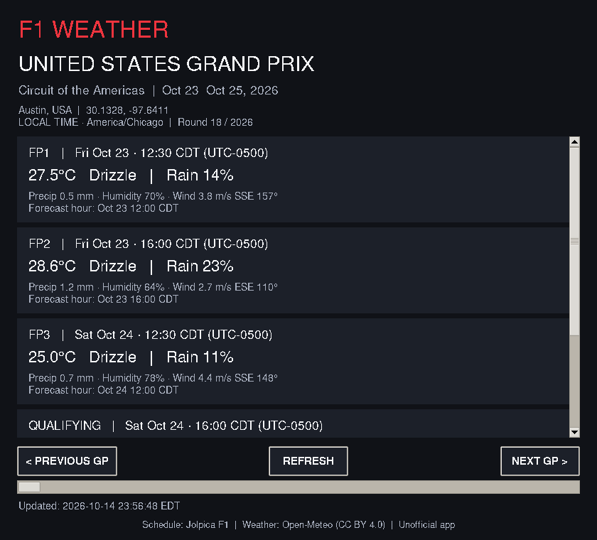

# F1 Weather

F1のGPを選び、各セッションの現地開始時刻と、その時刻に最も近い時間別天気予報を確認するmacOS向けTkinterアプリです。非公式・非商用の個人利用を想定しています。

## スクリーンショット



画面を更新した場合は `docs/screenshot.png` を差し替えてください。掲載画面はLinux上のTkで確認したものです。macOSではフォントやボタンの表示に差があります。

## 必要環境

- macOSのデスクトップ環境、Python **3.11以上**（3.12〜3.14推奨）
- Pythonに対応したTkinter/Tcl/Tk、OSのIANAタイムゾーンデータ
- インターネット接続。APIキー・pip追加ライブラリ不要

まず以下でTkのテストウィンドウが開くことを確認してください。

```bash
python3 --version
python3 -m tkinter
```

`_tkinter` が見つからない場合は [python.orgのmacOS用インストーラー](https://www.python.org/downloads/macos/) でPythonを導入してください。インストール後に新しいターミナルを開いて確認します。Homebrew版はPythonと同じバージョンのTkパッケージが必要です（例: `brew install python@3.14 python-tk@3.14`）。Tkinterはpipでは導入できません。

SSL証明書エラー（`CERTIFICATE_VERIFY_FAILED`）の場合、python.org版に付属する証明書設定を実行してください。Python 3.11の場合は次のコマンドです（別バージョンは番号を変更）。完了後にアプリのREFRESHを押してください。

```bash
open "/Applications/Python 3.11/Install Certificates.command"
```

証明書検証を無効化する実装にはしていません。

## インストール・起動

以下をターミナルで実行してください。

```bash
git clone https://github.com/fenrirlone9395/f1-weather.git f1-weather
cd f1-weather
python3 -m venv .venv
source .venv/bin/activate
python3 -m pip install -r requirements.txt
python3 app.py
```

ZIPを展開した場合は、ターミナルで展開後の `f1-weather` フォルダーに移動して、`python3 -m venv .venv` 以降を実行します。次回以降は次の2行で起動できます。

```bash
source .venv/bin/activate
python3 app.py
```

## 主な機能・使い方

- 起動時、2026年のうち決勝開始が現在のUTC日時より後となる最も近いGPを選びます。週末途中でも決勝前ならそのGPを選び、全戦終了後は最終戦を表示します。
- `PREVIOUS GP` / `NEXT GP` でAPIから取得したカレンダーの前後へ移動。最初・最後のボタンを無効化します。
- `REFRESH` でカレンダーと選択GPの天気を再取得。選択GPは維持します。通信中は進捗表示し操作を無効化します。Tkの処理は停止しません。
- 通常／Sprint週末のセッションはAPIに存在する項目だけを表示します。セッション日時や週末構成を捏造しません。
- 天気状態、気温、降水確率、降水量、湿度、10m風速・風向を表示。数値がnullの場合は `—` です。
- 各カードには実際に採用した `Forecast hour` も表示します。30分ちょうどの同距離では早い時間を採用します。
- コンパクトなウィンドウにスクロール表示。`Updated` は取得処理の完了時刻で、PC側のタイムゾーン表記です。気象モデルの更新時刻ではありません。

## 使用API・公式仕様

2026年10月15日に公式ドキュメントとライブ応答を確認しました。

### Jolpica F1

- [公式APIドキュメント](https://github.com/jolpica/jolpica-f1/blob/main/docs/README.md)
- [レース／セッションのレスポンス定義](https://github.com/jolpica/jolpica-f1/blob/main/docs/endpoints/races.md)
- 取得先: `https://api.jolpi.ca/ergast/f1/2026/?limit=100`
- GP名、サーキット、座標、決勝日・時刻、練習・予選・Sprint関連日時を取得します。セッション時刻はUTCです。
- `SprintQualifying`、`SprintShootout` の両フィールドを処理します。2026年の取得データではSprint Qualifyingが提供されています。
- 取得時点で23 GPが返りました。開催変更・欠落も含めAPIの内容に追従します。2026年カレンダーの完全性を独自に保証するものではありません。

### Open-Meteo

- [公式Forecast API仕様](https://open-meteo.com/en/docs)
- [利用条件](https://open-meteo.com/en/terms) / [ライセンス・帰属表示](https://open-meteo.com/en/licence)
- `https://api.open-meteo.com/v1/forecast` に `forecast_days=16`、`timezone=auto`、`timeformat=unixtime`、`wind_speed_unit=ms` を指定。
- 時間別変数: `weather_code,temperature_2m,precipitation_probability,precipitation,relative_humidity_2m,wind_speed_10m,wind_direction_10m`
- 天気コードはWMOの説明に変換。風向は風が吹いてくる方位です。
- 降水量は時間別データの該当時間までの1時間積算です。セッション全体の積算や開始瞬間の雨量ではありません。降水確率も該当時間の値です。
- 無料公開APIは非商用利用と利用制限の条件があります。商用化・配布規模拡大時は各サービスの最新条件を再確認してください。
- Weather data by Open-Meteo.com, [CC BY 4.0](https://creativecommons.org/licenses/by/4.0/)。アプリ内にも帰属表示を掲載しています。

## 日時・データ補完の設計

内部モデルはUTCのaware datetimeを使用します。Open-MeteoのUnix時刻もUTCへ変換してから照合するため、夏時間の切り替えで同じ現地時刻が2回現れても混同しません。GUIではIANA ZoneInfoでセッションごとの夏時間を計算し、`LOCAL TIME`・タイムゾーン名・UTCオフセットを表示します。

Jolpicaにはタイムゾーンがないため、`local_data.py` にサーキットID→IANAゾーンだけを分離しています。天気取得時の `timezone=auto` の応答を優先し、通信失敗時にはこの辞書を使います。両方不明ならUTC表示へ切り替えて明示します。カレンダーや日時のローカル補完はありません。

## ディレクトリ構成

```text
f1-weather/
├── app.py              # 起動エントリーポイント
├── gui.py              # Tk画面・バックグラウンド通信の制御
├── f1.py               # Jolpica取得・解析
├── weather.py          # Open-Meteo取得・時刻照合・表示用変換
├── models.py           # GUIに依存しないUTCモデル・次戦選択
├── local_data.py       # ローカルのIANAタイムゾーン補完
├── network.py          # タイムアウト付きJSON通信・例外
├── tests/              # オフライン単体テスト・GUIスモークテスト
├── docs/               # スクリーンショット・検証記録
├── requirements.txt
├── README.md
└── .gitignore
```

GUI以外のモジュールはTkに依存しないため、Web・ウィジェット等の別フロントエンドから再利用できます。

## 検証

```bash
python3 -m compileall -q .
python3 -m unittest discover -s tests -v
python3 tests/gui_smoke.py
```

GUIスモークテストはデスクトップ環境が必要です。単体テストはAPIへ通信せず、通常／Sprint、欠損情報、通信失敗、不正応答、予報範囲、同距離時刻、夏時間・日付繰り越しを確認します。ライブAPIは開発時に別途確認しました。結果は `docs/VALIDATION.md` を参照してください。

## 既知の制限

- macOS / Python 3.11で、付属の証明書設定後に動作したとの利用者報告があります。開発側ではLinux上のTkで起動・画面生成を検証しています。
- 対象シーズンは2026年固定。開催変更・日時未発表・キャンセル等の反映はJolpicaの更新に依存します。情報不足は画面に警告します。
- 最大16日程度の予報です。返却データ範囲外は `Forecast not available yet`、過去セッションは `Past session — forecast unavailable` と表示。過去の観測や再予報は取得しません。
- 開始時刻に最も近い予報だけを使い、セッション中の変化は表示しません。時間差が30分を超える欠落データも採用しません。
- 更新は手動。通信タイムアウトは各リクエスト18秒で、自動リトライやキャッシュはありません。オフラインでの初回起動時はカレンダーを表示できません。更新失敗時は既存カレンダーを維持しますが天気を消し、失敗を表示します。
- 天気はサーキット座標付近のモデル予測であり、路面温度・局地的な雨・レーダー情報ではありません。
- 本プロジェクトのコードと、APIから取得する第三者データの権利・利用条件は別です。F1公式アプリではありません。
